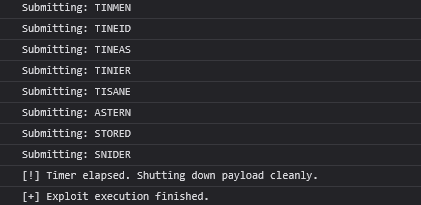
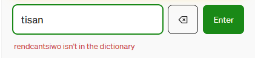
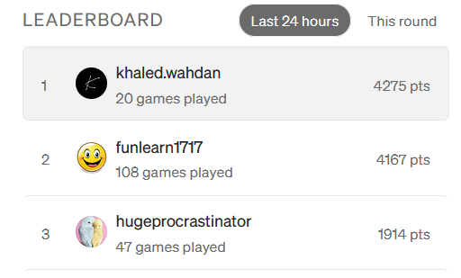

# Automating Medium's 'Good Words'

### Objective
Today, October 10th at 4:00 PM, I found out about Medium—an online publishing and social journalism platform. I signed up and immediately noticed a button that says "Play Games." They have a Boggle-style word puzzle game called **Good Words**. It presents a 5x5 board of random letters, and the player's goal is to find and connect hidden words within the grid before a 3-minute timer runs out. All players compete on the same board and are ranked afterward.

The rules are straightforward:
* **Direction:** You can move from one letter to the next horizontally, vertically, or diagonally.
* **No Snaking Back:** You cannot use the exact same grid tile/letter twice in a single word.
* **Length:** Words must be a minimum of 4 letters long.

After playing a few rounds, I found the way the game is unified for multiple users very interesting and asked myself how it is implemented. I inspected the HTML and found that the grid generation, the timer, and the word validation were all happening client-side in my browser! I realized that if I could read the board state using JavaScript, I could write a script to find as many words as possible and submit them, achieving a massive score. I decided to exploit this architecture to deepen my practical understanding of web security.

---

### The Plan
The plan was to write a script that could find as many words as possible and automate the submission process. The script needed to:
1. **Extract** the live board state (letters and their coordinates) from the browser.
2. **Cross-reference** those letters against an English dictionary to find valid paths.
3. **Simulate** human interactions to submit the words.
4. **Stop** cleanly when the round ended.

---

### Research & Architecture
To figure out how everything worked, I conducted brief research on the underlying mechanics. 

Basically, my browser doesn't constantly ask the server what the time or letters are. Instead, when the game loads, the server sends all the data along with a timestamp for when the board expires. My browser then uses internal JavaScript functions to show the countdown. 

Once the timer hits zero, a script automatically runs, locking down my input so I can't type more words, and it prepares to talk to the server again. Before the new board updates, JavaScript gathers my statistics, and my browser makes an asynchronous HTTP `POST` request to an API endpoint. Medium's backend API receives the score and updates it in the database. Simultaneously following the submission, my browser makes a separate `GET` request and receives a text payload in a raw data format called JSON, which the browser catches to update the data on my screen.

---

### Phase 1: Seeing the Board (DOM Scraping)
My first thought was that instead of reading the data from the API, I could just read it directly from my browser. After I inspected the HTML and located the data, I found out that each letter was housed inside a standard HTML `<button>` element. 

This brings us to the **DOM (Document Object Model)**. It is a programming interface for web documents that represents HTML or XML pages as a tree structure of objects so that languages like JavaScript can read, change, or style the content.

Using standard `document.querySelectorAll()` methods, I was able to scrape the DOM, extracting both the letters and the direct references to the physical button elements.

---

### Phase 2: Finding the Words (Graph Theory)
**Depth-First Search (DFS)** is a tree traversal algorithm that explores a path as deeply as possible before backtracking to try other branches. Since you can move horizontally, vertically, and diagonally in the game, DFS was the perfect solution for finding words. 

*(Fun fact: DFS relies on a LIFO structure—Last-In, First-Out—to remember its path!)*

Theoretically, loading a dictionary and using the algorithm to compare each path to existing words in the database should work. But since the letters are scattered randomly and there are a lot of clearly invalid paths, I optimized it: if the first few letters don't make up a valid prefix, the script drops that path right away.

Initially, I fed the algorithm a massive 370,000-word English dictionary by fetching it from GitHub. When I tested it, it found hundreds of words, but the game rejected a lot of them. 

I solved this by swapping the dictionary source to a standard Scrabble word list, which perfectly aligned with the game's internal dictionary.

---

### Phase 3: Typing the Guesses (Interaction)
Once the script knew the words, it needed to type them. I tried to simulate keyboard presses using `KeyboardEvent`, but it didn't work due to the nature of modern frontend frameworks. They are smart and often ignore synthetic keyboard events that lack a true hardware signature (the `isTrusted` flag). 

I simply pivoted from keyboard inputs to simulated clicks. Since I saved the references from the DOM during the extraction phase, I told the script to trigger mouse events directly on the tiles, tracing the path exactly like a human would.

---

### The Result
To ensure the payload didn't behave like an obvious bot, I added randomized delays between clicks, scaling the "thinking time" based on the length of the word. I also made sure the script strictly stopped executing when the 3-minute round ended.

---

### Core Security Concepts Learned
This project was an incredible practical exercise in client-side web mechanics, which helped me understand:
* **DOM Manipulation & State Extraction:** How frontends hold valuable data that can be scraped and weaponized by a client.
* **Algorithmic Optimization:** Using Prefix Sets (Tries) to kill invalid DFS paths early, preventing browser crashes.
* **Synthetic Event Spoofing:** Understanding how modern frameworks handle event binding, and how to forge comprehensive `MouseEvent` payloads to bypass basic input validation.

---

### Defensive Mitigation: How Medium Could Prevent This
If I were on the blue team defending this application, here are the recommendations I would make to mitigate this kind of automation:
1. **Move Away from the DOM:** Rendering the game board on an HTML5 `<canvas>` element instead of using standard HTML `<button>` tags would break standard DOM extractions.
2. **Strict Server-Side Validation:** Implement behavioral rate-limiting. If the backend receives a large volume of 8-letter word submissions spaced exactly 1 second apart, the session should be flagged.
3. **Event Trust Verification:** Enforce strict checks on the `Event.isTrusted` property for all inputs to ensure they originate from physical hardware.

---
# أتمتة لعبة "Good Words" 

### الهدف
اليوم، 10 أكتوبر الساعة 4 العصر، اكتشفت منصة Medium، وهي منصة للنشر والصحافة الاجتماعية. سجلت فيها ولاحظت فوراً زر مكتوب عليه "العب ألعاباً". عندهم لعبة كلمات بتصميم يشبه لعبة بوجل اسمها **Good Words**. فكرتها إنها تعطيك شبكة حروف عشوائية بحجم 5x5، وهدفك كلاعب إنك تلاقي وتشبك كلمات مخفية داخل الشبكة قبل ما يخلص العداد اللي مدته 3 دقايق. كل اللاعبين يتنافسون على نفس الشبكة في نفس الوقت ويتم ترتيبهم في قائمة المتصدرين بعد انتهاء الوقت.

القوانين بسيطة:
* **الاتجاهات:** تقدر تتحرك من حرف للثاني أفقياً، عمودياً، أو قطرياً.
* **عدم التكرار:** ما تقدر تستخدم نفس المربع/الحرف مرتين في نفس الكلمة.
* **الطول:** الكلمات لازم تكون مكونة من 4 حروف على الأقل.

بعد ما لعبت كم جولة، لفت انتباهي كيف إن اللعبة موحدة لجميع المستخدمين في نفس الوقت وسألت نفسي: كيف برمجوها؟ فحصت الـ HTML واكتشفت إن بناء الشبكة، العداد، والتحقق من الكلمات كلها تصير في جهة العميل على متصفحي! استوعبت إني لو قدرت أقرأ حالة الشبكة باستخدام جافا سكريبت، أقدر أكتب سكربت يطلع أكبر عدد ممكن من الكلمات ويرسلها تلقائياً، وأجيب سكور عالي جداً. فقررت أستغل هالشيء وأعمق فهمي في أمن الويب بشكل عملي.

---

### الخطة
الخطة كانت إني أكتب سكربت يقدر يصيد أكبر عدد ممكن من الكلمات ويأتمت عملية الإرسال. عشان كذا، السكربت لازم:
1. **يستخرج** حالة الشبكة الحالية (الحروف وإحداثياتها) مباشرة من المتصفح.
2. **يقاطع** هذي الحروف مع قاموس إنجليزي عشان يلاقي المسارات الصحيحة للكلمات.
3. **يحاكي** تفاعل الإنسان (النقرات) عشان يرسل الكلمات.
4. **يوقف** بشكل نظيف أول ما ينتهي الجولة.

---

### البحث والمعمارية
عشان أفهم كيف كل شيء يشتغل، سويت بحث بسيط في آليات اللعبة. 

باختصار، متصفحي ما يطلب من السيرفر الوقت أو الحروف بشكل مستمر. بدال كذا، أول ما تحمل اللعبة، السيرفر يرسل كل البيانات مع طابع زمني يحدد متى تنتهي الشبكة الحالية. متصفحي بعدها يستخدم دوال جافا سكريبت داخلية عشان يعرض العد التنازلي. 

أول ما يوصل العداد لصفر، يشتغل سكربت تلقائياً يقفل مدخلاتي عشان ما أقدر أكتب كلمات زيادة، ويجهز نفسه عشان يكلم السيرفر مرة ثانية. قبل ما تتحدث الشبكة الجديدة، جافا سكريبت تجمع إحصائياتي ومتصفحي يرسل طلب HTTP POST غير متزامن لنقطة نهاية (API). بعدها، الـ API الخاص بـ Medium يستلم السكور ويحدثه في قاعدة البيانات. بالتزامن مع هالإرسال، متصفحي يسوي طلب `GET` منفصل ويستقبل البيانات الخام بصيغة JSON، واللي المتصفح ياخذها ويحدث فيها البيانات على شاشتي.

---

### المرحلة الأولى: قراءة الشبكة (استخراج الـ DOM)
أول فكرة جتني هي: بدل ما أقرأ البيانات من الـ API، ليش ما أقرأها مباشرة من متصفحي؟ بعد ما فحصت الـ HTML وحددت مكان البيانات، اكتشفت إن كل حرف موجود داخل عنصر `<button>` قياسي في الـ HTML. 

وهذا ياخذنا لمفهوم الـ **DOM**. هو عبارة عن واجهة برمجية لمستندات الويب تمثل صفحات الـ HTML أو الـ XML على شكل شجرة كائنات عشان لغات مثل جافا سكريبت تقدر تقرأ، تعدل، أو تغير شكل المحتوى.

باستخدام دوال `document.querySelectorAll()` القياسية، قدرت أسحب البيانات من الـ DOM وأستخرج الحروف والمراجع المباشرة لعناصر الأزرار الفعلية.

---

### المرحلة الثانية: البحث عن الكلمات (نظرية المخططات)
خوارزمية البحث في العمق أولاً (**DFS**) هي خوارزمية للمرور على الشجرة تستكشف المسار لأعمق نقطة ممكنة قبل ما تتراجع عشان تجرب فروع ثانية. بما إنك تقدر تتحرك أفقياً، عمودياً، وقطرياً في اللعبة، خوارزمية DFS كانت الحل المثالي للبحث عن الكلمات. 

*(معلومة حلوة: تعتمد خوارزمية DFS على هيكل LIFO - الأخير دخولاً هو الأول خروجاً - عشان تتذكر مسارها!)*

نظرياً، تحميل قاموس واستخدام الخوارزمية لمقارنة كل مسار بالكلمات الموجودة في قاعدة البيانات المفروض يشتغل. لكن لأن الحروف متوزعة عشوائياً وفيه مسارات كثيرة مستحيل تكون كلمات صحيحة، سويت تحسين في الكود: إذا الحروف الأولى ما شكلت بداية صحيحة لكلمة، السكربت يترك هذا المسار فوراً.

في البداية، عطيت الخوارزمية قاموس إنجليزي ضخم فيه 370,000 كلمة سحبته من GitHub. لما اختبرته، لقى مئات الكلمات، لكن اللعبة رفضت كثير منها. 

حليت هالمشكلة بتبديل مصدر القاموس لنسخة قياسية من قواميس لعبة "سكرابل"، واللي تطابقت تماماً مع القاموس الداخلي للعبة.

---

### المرحلة الثالثة: كتابة التخمينات (التفاعل)
بعد ما عرف السكربت الكلمات، صار لازم يكتبها. حاولت أحاكي ضغطات الكيبورد باستخدام `KeyboardEvent`، لكنها ما اشتغلت بسبب طبيعة أطر عمل الواجهات الأمامية الحديثة. هذي الأطر ذكية وتتجاهل غالباً أحداث الكيبورد المصطنعة اللي تفتقد للتوقيع الحقيقي للأجهزة (الـ flag المسمى `isTrusted`). 

بكل بساطة غيرت الطريقة من مدخلات الكيبورد إلى محاكاة النقرات. وبما إني حافظ المراجع الخاصة بالـ DOM خلال مرحلة الاستخراج، وجهت السكربت إنه يطلق أحداث الماوس مباشرة على المربعات، بحيث يتتبع المسار تماماً كأنه إنسان حقيقي يضغط عليها.

---

### النتيجة
عشان أضمن إن السكربت ما يتصرف كأنه بوت واضح، أضفت تأخيرات عشوائية بين النقرات، وخليت "وقت التفكير" يتناسب مع طول الكلمة. وتأكدت تماماً إن السكربت يوقف تنفيذ أول ما تنتهي الـ 3 دقايق الخاصة بالجولة.

---

### المفاهيم الأمنية الأساسية اللي تعلمتها
هالمشروع كان تمرين عملي رهيب في ميكانيكيات الويب لجهة العميل، وساعدني أفهم:
* **التلاعب بالـ DOM واستخراج الحالة:** كيف الواجهات الأمامية تحتفظ ببيانات قيمة يقدر العميل يستخرجها ويستخدمها كسلاح.
* **التحسين الخوارزمي:** استخدام مجموعات البدايات لقتل مسارات DFS الخاطئة مبكراً، ومنع المتصفح من الانهيار.
* **تزييف الأحداث المصطنعة:** فهم كيف تتعامل أطر العمل الحديثة مع ربط الأحداث، وكيفية تزييف أحداث ماوس شاملة (`MouseEvent`) لتجاوز آليات التحقق الأساسية للمدخلات.

---

### التخفيف الدفاعي: كيف تقدر Medium تمنع هذا الشيء؟
لو كنت في الفريق الأزرق اللي يدافع عن هالتطبيق، هذي التوصيات اللي بقدمها للحد من هذي الأتمتة:
1. **الابتعاد عن الـ DOM:** عرض لوحة اللعبة على عنصر `<canvas>` في HTML5 بدال استخدام أزرار `<button>` العادية بيكسر طرق استخراج الـ DOM القياسية.
2. **تحقق صارم من جهة السيرفر:** تطبيق تحديد معدل السلوك. إذا استقبل السيرفر حجم كبير من الكلمات المكونة من 8 حروف وبفارق زمني دقيق جداً (ثانية واحدة مثلاً)، المفروض تتصنف الجلسة كمشبوهة.
3. **التحقق من موثوقية الحدث:** فرض فحوصات صارمة على خاصية `Event.isTrusted` لكل المدخلات لضمان إنها جاية من أجهزة حقيقية فعلية.

